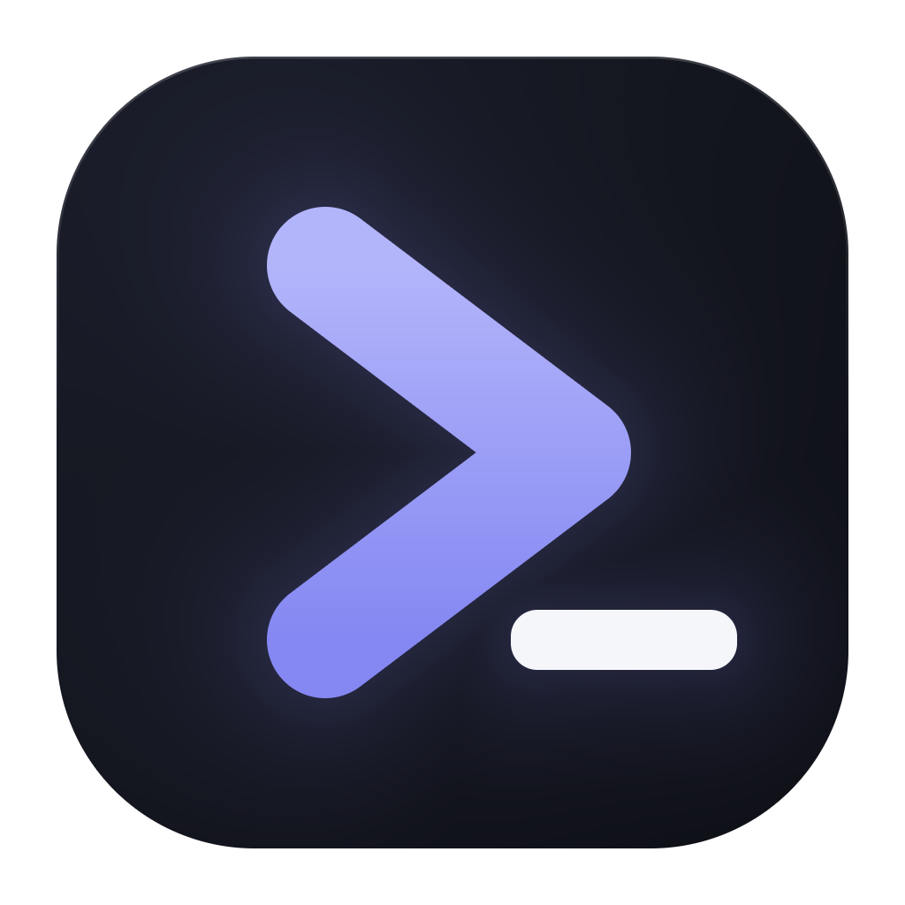

<p align="center">
  
</p>

# FineVibe — the `leo-3889/finevibe` fork

> **Fork notice.** This repository — [leo-3889/finevibe](https://github.com/leo-3889/finevibe), the public fork — is a
> fork of **[elirantutia/vibeyard](https://github.com/elirantutia/vibeyard)**, branched from upstream `v0.3.8`
> (Sep 2026). The product is **FineVibe** (the fork's rebrand of Vibeyard); upstream
> keeps its own name. For the product as its authors describe it, read the
> **[upstream README](https://github.com/elirantutia/vibeyard#readme)** —
> [`README.upstream.md`](README.upstream.md) is a snapshot of it with the provider and profile lines updated to
> describe this fork, so it is *not* verbatim; upstream's own README lags this code.

| | |
|---|---|
| **Upstream** | [elirantutia/vibeyard](https://github.com/elirantutia/vibeyard) |
| **This fork** | [leo-3889/finevibe](https://github.com/leo-3889/finevibe) |
| **Upstream PR** | [#167](https://github.com/elirantutia/vibeyard/pull/167) |

This README covers what the fork adds on top of the upstream product; the base product's Highlights live in
[`README.upstream.md`](README.upstream.md) and are not restated here.

---

## What this fork adds on top of the upstream product

### Seven CLI backends

- **Pi sessions** — drive the Pi coding agent (`pi`) in a full session tab: spawn, resume, live status — alongside the four upstream CLIs.
- **Pi-Bolt sessions** — drive the Pi coding agent compiled ahead-of-time to native code (`pi-bolt`) in a full session tab: same `~/.pi/agent` sessions, spawn, resume, live status.
- **Oh my Pi sessions** — the same first-class treatment for `omp`. Seven backends in total: Claude Code, Codex, Copilot, Gemini, Pi, Pi-Bolt, and Oh my Pi.

### Live session state without hooks

- **Polled transcript sync** — CLIs with no hook support are first-class: a single provider-agnostic poller mirrors transcript state (status, name, title) into the same channels the rest of the UI consumes. No dead boxes.

### Profiles per tool

- **One default profile per coding tool** (Claude, Pi, OMP), resolved once per session and pinned — pick a profile per session, per project, or as a per-tool default.
- **`Tool · Profile` sidebar badge** — reads that same resolution, so the UI can't promise a profile the next session won't get.

### Multi-host SSH — work on machines that aren't this one

- **Enroll a host in Settings → Hosts** — name, user, port, and either an SSH key (leave the key path empty and FineVibe generates its own key pair for that host) or a password, kept in the system keychain and never read back by the UI. **Test** probes the connection; on first contact the host key's fingerprint is shown and nothing is trusted until you approve it. A fingerprint that changes later is a hard refusal, never a silent re-trust.
- **Enroll to switch on the remote tooling** — Enroll deploys the managed key, probes which coding tools are installed on that machine, and installs FineVibe's status hooks. Each host shows its state (`Draft`, `Auth OK`, `Enrolled`, `Partial`, `Failed`) with the per-binary report behind a `Partial`.
- **Add projects that live on the host** — with a host selected in the sidebar, the Add-project modal's verbs run on that machine: a folder browser over the remote filesystem, `Create` for a missing folder, and a git-URL checkout that clones on the host.
- **Run sessions there** — open a shell tab on the host, or launch a coding tool with that host selected; the tab gets live status, titles and transcripts read off the host. The file tree, preview, quick-open, search, and the git panel (including staging and discarding) all address the remote project — never a local scan of the same name.
- **Per-host tools, profiles and settings** — Setup and Profiles show one machine at a time (the tools installed *on that host*, its profiles, its defaults), and **Sync settings** pushes your Pi / Pi-Bolt / Oh my Pi configuration to the host, warning first when the remote files have drifted.

The host registry, key pinning, and secret handling are specified in [docs/hosts.md](docs/hosts.md).

### Windows first-class, Linux packaged

- **Built and checked on Windows 11** — ConPTY key encoding (arrows/Escape work in vim/less), safe `cmd.exe` argument quoting, Windows Python detection for hooks, icon/version-stamped builds.
- **Full artifact matrix on fork Releases** — Windows Setup + portable + zip, macOS dmg/zip (signed, notarized), Linux `.deb` + AppImage. Builds ship as `FineVibe` installers with their own icon.

### Auto-update from the fork, never upstream

- **Fork-only release feed** — the packaged auto-updater (checked shortly after start, then every 4 h) reads the feed baked into its own `resources/app-update.yml`, which the build pins to this repo's GitHub Releases; `FINEVIBE_RELEASE_REPO` only overrides it. The npm launcher, which has no baked feed, requires `FINEVIBE_RELEASE_REPO`. Either way a malformed value fails closed — a fork build never pulls upstream bytes.
- **Linux updates from the AppImage** — the AppImage build checks that baked feed on its own and installs the update on quit, no environment variable and no terminal needed. The `.deb` deliberately stays on apt: the Linux release feed carries the AppImage, so a deb install answers with the `apt install ./FineVibe-<version>-linux-amd64.deb` command instead of a check that can only fail. The portable `.exe` behaves the same way and points at the launcher.
- **A manual check tells you the truth** — About → *Check for Updates* runs through the same gates: on a deb, a portable `.exe`, or a build whose feed is missing or names another repo, it shows the reason updates are off rather than a fake "Update failed".

### Selecting, copying, and typing in a terminal pane

- **Plain left-drag selects text** — in a full-screen TUI that grabs the mouse (a Pi / Pi-Bolt session, `vim`, `fzf`, lazygit), dragging with the left button selects terminal text as it does in any other terminal, and the selection is copyable the moment you release the button.
- **Alt+drag hands the mouse to the app** — hold Alt (Option on macOS) to give the press to the TUI instead, for its own click UI: vim mouse selection, `fzf` mouse picking, btop panels.
- **Right-click keeps your selection** — finish a drag and right-click: the selection is intact, so **Copy** in the context menu (and the copy chord) copies the text you selected. With nothing selected, right-click goes to the TUI untouched.
- **Copy on select is opt-in** — Preferences → General → *Copy on select* copies each selection automatically; with it off (the default) nothing reaches the clipboard until you ask.
- **`Ctrl+Shift+C` always copies** (`⌘⇧C` on macOS, `⌘C` too) — in session tabs, the project shell, and a shared session's pane alike.
- **Option is Meta on macOS** — `⌥←`/`⌥→`, `⌥B`/`⌥F` and the Meta arrows reach the CLI as word-wise motion instead of composing a Unicode character, in every pane type.
- **Preferences where you'd look for them** — `⌘,` opens Preferences on macOS, even while a terminal or a text field owns the keyboard (the sidebar gear opens it on Windows and Linux), and *Copy on select* sits in its General section.

### The app behaves like a desktop app

- **Closing the window on macOS doesn't quit** — the app stays in the Dock and its sessions keep running; clicking the Dock icon reopens the window (restoring it if it was minimized). On Windows and Linux, closing the window quits, as expected.
- **Quit asks before interrupting sessions** — quitting with active sessions shows *Quit FineVibe* with the session count. **Cancel** returns to the app and nothing is torn down behind it.
- **The window comes back as you left it** — size and position persist across launches; bounds remembered on a monitor that's no longer attached fall back to a centered default window instead of an invisible one.
- **`Ctrl+Shift+F5` reloads the window** — the same recovery on all three platforms for a wedged renderer, without quitting the app. On macOS the menu's **Close Window** is `⌘⇧W`, leaving `⌘W` to close sessions.

### Migration from `~/.vibeyard`

- **First-launch data migration** — copies `~/.vibeyard` (and `%APPDATA%\Vibeyard` on Windows) into the new user-data directory: copy-only, legacy trees kept, locked files retried next launch.
- **Legacy project import** — a sidebar button, shown only when candidates exist, lists projects from the legacy `~/.vibeyard/state.json` that the live store doesn't have; pick and import them in one dialog.

### Session workflow refinements

- **Session tab groups** — drag a tab onto another tab's center zone to group; labeled groups with member count, inline rename, ungroup menu, persisted per project.
- **Tab-strip scroll arrows** — overflowing tab strips get ‹ › step arrows with per-project scroll-offset memory.
- **Ask-AI focus preference** — choose whether Ask-AI / browser-tab sends open the new session tab focused (default) or in the background, so your current tab keeps focus.
- **Per-provider plan-mode matrix** — the plan-mode tick appears only where the CLI supports it at startup (Claude, Copilot, Gemini, OMP); Pi is disabled with a tooltip and Codex support is unverified — never silently ignored.
- **Rich paste into terminals** — paste images, files, URIs, and HTML into any CLI pane: files arrive as quoted paths, screenshots are materialized to disk.
- **Instant plain-text paste** — a clipboard-latency program: zero clipboard IPC for plain text on all three platforms, PNG encoding off the main thread, coalesced PTY output.
- **Sidebar folder refresh** — expanding a folder re-reads the listing from disk, so files created by agents outside the watcher's view show up immediately.
- **Copy path** — right-click → Copy path in the file tree and the project sidebar.
- **New-session persona + prompt rows** — launch a team persona straight from the New Session modal and type its first message there; delivered at spawn on all seven providers.
- **Per-member backend pin** — pin a team member to a specific provider/profile; the pin wins at launch from any launch surface.
- **Session export** — every session is recorded from creation; export any archived session as a zip archive or a single transcript file.
- **Default projects folder + git-URL checkout** — new projects pre-fill under your chosen projects folder; paste a GitHub/Codeberg URL to clone the repo and create the project in one step.

The complete per-feature reference — behavior, owning module, numeric limits — lives in
[`docs/FEATURES.md`](docs/FEATURES.md); provider spawn contracts in
[`docs/provider-contracts.md`](docs/provider-contracts.md).

## Documentation

All eight contract docs (providers, hosts, session lifecycle, security boundaries,
performance, UI conventions, packaging, feature reference) are indexed in
[`docs/README.md`](docs/README.md).

## What it does *not* do

- **The product is FineVibe, the fork's rebrand of Vibeyard.** Upstream keeps the Vibeyard name, its UI copy, and its data format; the fork renames the product and its artifacts (`FineVibe-…` installers, the `finevibe` npm package) and migrates `~/.vibeyard` data on first launch.
- No fork-only telemetry, analytics, or phone-home.
- No config lock-in or migration that blocks a return to upstream.
- No upstream feature removed or disabled.

## Known limits

- **Cost and context tracking stay Claude-only** — every other backend, including Pi and OMP, runs without the cost/context rail.
- **`pi`, `omp` and `pi-bolt` must be on `PATH`** (or resolvable via nvm/npm-global probing) — a provider whose binary isn't found stays hidden.
- **macOS and Linux are unverified in this delta** — no new platform-specific code beyond `src/main/platform.ts`, but neither OS was exercised.
- **Pi-Bolt shares `~/.pi/agent` with Pi** — Pi-Bolt-launched sessions use their own `pi-bolt-sessions` dir; terminal-launched `pi-bolt` sessions appear under the Pi provider.
- **Updates arrive only from the fork's release feed** — never upstream; a malformed `FINEVIBE_RELEASE_REPO` override disables auto-update, and without the variable the launcher refuses to download.
- **Linux artifacts are x64-only** — launcher and release matrix ship amd64; no arm64 Linux builds.

## Install

Requires at least one supported CLI installed and authenticated; `pi`, `omp` and `pi-bolt` must be on `PATH` to appear.

### npm (macOS, Linux & Windows)

> **Not on npm yet.** The `finevibe` launcher publishes with the `4.0` cut; until then use
> the [installers below](#desktop-installers). `npm i -g finevibe` returns 404 today.

```bash
npm i -g finevibe
FINEVIBE_RELEASE_REPO=leo-3889/finevibe finevibe
```

The launcher downloads the matching build from this repo's Releases (HTTPS, sha256-verified) into
`~/.finevibe/app` and launches it — on Linux that build is the AppImage
(`FineVibe-<version>-linux-x86_64.AppImage`), the same artifact the in-app updater ships, while the `.deb`
below updates through apt. The feed variable is required — without it the launcher refuses to
download. Node ≥18 for the launcher; Windows and Linux are x64-only (a win-arm64 run is refused — no such
asset is published).

### Desktop installers

From the fork's [Releases](https://github.com/leo-3889/finevibe/releases):

- **Windows (x64)** — `FineVibe-Setup-<version>.exe` (NSIS) or `FineVibe-<version>.exe` (portable); `FineVibe-<version>-win-x64.zip` (no arm64 asset is published)
- **macOS** — signed, notarized `.dmg` / `FineVibe-<version>-mac.zip`
- **Linux (x64)** — `FineVibe-<version>-linux-amd64.deb` or `FineVibe-<version>-linux-x86_64.AppImage`

```bash
# Debian/Ubuntu — installs to /opt/FineVibe, CLI at /usr/bin/finevibe
sudo apt install ./FineVibe-<version>-linux-amd64.deb
```

The `.deb` installs the app icon at every desktop size (16→1024 px), so the launcher and dock icon resolves on a stock GNOME/KDE desktop; the AppImage path gets the same icon through its installed desktop entry.

### Build from source

```bash
git clone https://github.com/leo-3889/finevibe.git
cd finevibe
npm install
npm start     # builds main + preload + renderer, then launches (no hot reload)
npm test      # vitest
```

Requires Node 24 (`.nvmrc`). For an ad-hoc Ubuntu `.deb` from any branch: run the **Ubuntu package**
workflow from Actions and download the `finevibe-deb-x64` artifact.

## Sync

```bash
git remote rename origin upstream    # if you clone this fork
git remote add origin https://github.com/leo-3889/finevibe.git
git fetch upstream && git checkout main
git merge --ff-only upstream/main   # rebase if the fork has local commits
```

Once [#167](https://github.com/elirantutia/vibeyard/pull/167) merges, `main` sits ahead of upstream by
just the fork-only README.

## Contributing

PRs here are welcome. Anything generally useful gets forwarded upstream — that preference is why this
fork is public rather than local.

## License

MIT — see [LICENSE](LICENSE).

Dual copyright: upstream Vibeyard © Eliran Tutia; fork additions © leo-3889.

---

*Vibeyard is independent of Anthropic. This fork carries no added affiliation.*
