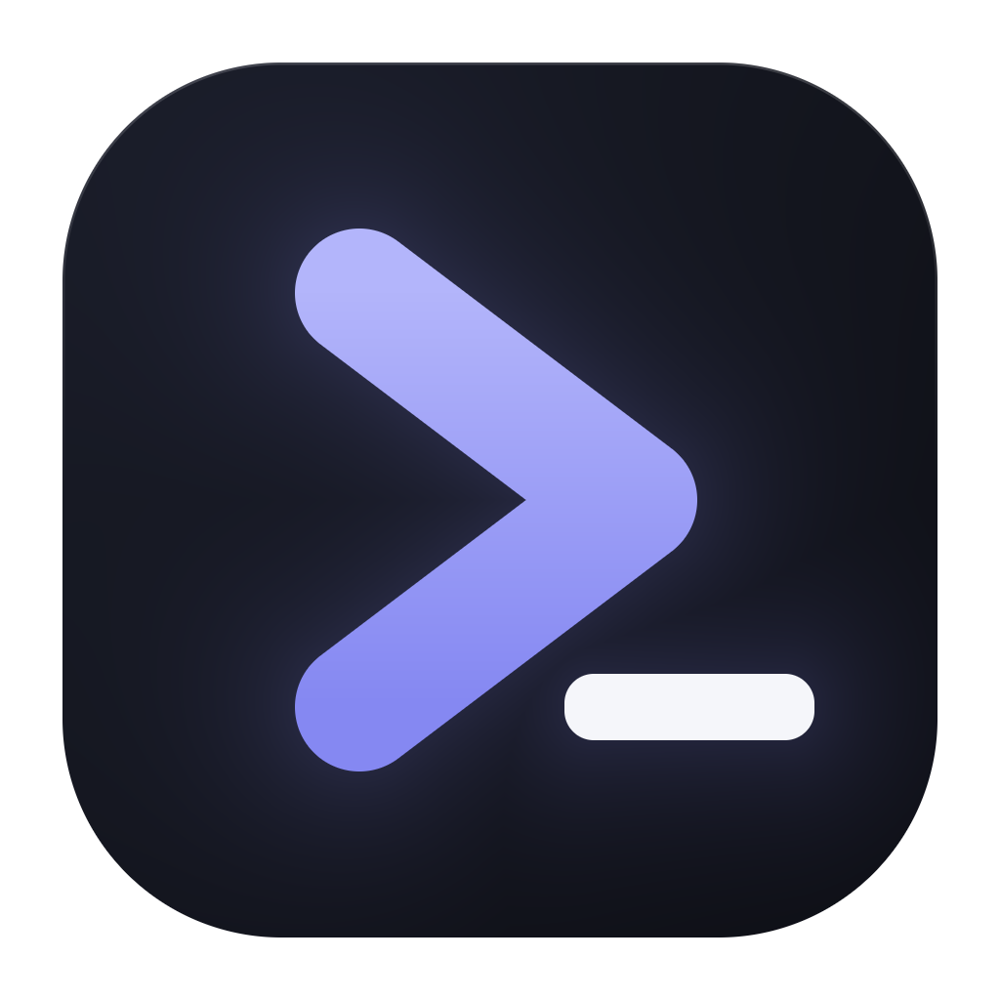

<p align="center">
  
</p>

# Vibeyard — the `leo-3889/finevibe` fork

> **Fork notice.** This repository — [leo-3889/finevibe](https://github.com/leo-3889/finevibe), the public fork — is a
> fork of **[elirantutia/vibeyard](https://github.com/elirantutia/vibeyard)**, branched from upstream `v0.3.8`
> (Sep 2026). The product is **Vibeyard**; only the fork's release artifacts carry FineVibe naming. For the product as
> its authors describe it, read the **[upstream README](https://github.com/elirantutia/vibeyard#readme)** —
> [`README.upstream.md`](README.upstream.md) is a snapshot of it with the provider and profile lines updated to
> describe this fork, so it is *not* verbatim; upstream's own README lags this code.

| | |
|---|---|
| **Upstream** | [elirantutia/vibeyard](https://github.com/elirantutia/vibeyard) |
| **This fork** | [leo-3889/finevibe](https://github.com/leo-3889/finevibe) |
| **Upstream PR** | [#167](https://github.com/elirantutia/vibeyard/pull/167) |

This README covers what the fork adds on top of Vibeyard; the base product's Highlights live in
[`README.upstream.md`](README.upstream.md) and are not restated here.

---

## What this fork adds on top of Vibeyard

### Seven CLI backends

- **Pi sessions** — drive the Pi coding agent (`pi`) in a full session tab: spawn, resume, live status — alongside the four upstream CLIs.
- **Pi-Bolt sessions** — drive the Pi coding agent compiled ahead-of-time to native code (`pi-bolt`) in a full session tab: same `~/.pi/agent` sessions, spawn, resume, live status.
- **Oh my Pi sessions** — the same first-class treatment for `omp`. Seven backends in total: Claude Code, Codex, Copilot, Gemini, Pi, Pi-Bolt, and Oh my Pi.

### Live session state without hooks

- **Polled transcript sync** — CLIs with no hook support are first-class: a single provider-agnostic poller mirrors transcript state (status, name, title) into the same channels the rest of the UI consumes. No dead boxes.

### Profiles per tool

- **One default profile per coding tool** (Claude, Pi, OMP), resolved once per session and pinned — pick a profile per session, per project, or as a per-tool default.
- **`Tool · Profile` sidebar badge** — reads that same resolution, so the UI can't promise a profile the next session won't get.

### Windows first-class, Linux packaged

- **Built and checked on Windows 11** — ConPTY key encoding (arrows/Escape work in vim/less), safe `cmd.exe` argument quoting, Windows Python detection for hooks, icon/version-stamped builds.
- **Full artifact matrix on fork Releases** — Windows Setup + portable + zip, macOS dmg/zip (signed, notarized), Linux `.deb` + AppImage. Builds ship as `FineVibe` installers with their own icon — artifact identity only; the product is Vibeyard.

### Auto-update from the fork, never upstream

- **Fork-only release feed** — the npm launcher and the packaged auto-updater (checked shortly after start, then every 4 h) fetch only from this repo's GitHub Releases via `FINEVIBE_RELEASE_REPO`. Unset or malformed, they refuse to download / disable themselves — a fork build never pulls upstream bytes.

### Migration from `~/.vibeyard`

- **First-launch data migration** — copies `~/.vibeyard` (and `%APPDATA%\Vibeyard` on Windows) into the new user-data directory: copy-only, legacy trees kept, locked files retried next launch.
- **Legacy project import** — a sidebar button, shown only when candidates exist, lists projects from the legacy `~/.vibeyard/state.json` that the live store doesn't have; pick and import them in one dialog.

### Session workflow refinements

- **Session tab groups** — drag a tab onto another tab's center zone to group; labeled groups with member count, inline rename, ungroup menu, persisted per project.
- **Tab-strip scroll arrows** — overflowing tab strips get ‹ › step arrows with per-project scroll-offset memory.
- **Ask-AI focus preference** — choose whether Ask-AI / browser-tab sends open the new session tab focused (default) or in the background, so your current tab keeps focus.
- **Per-provider plan-mode matrix** — the plan-mode tick appears only where the CLI supports it at startup (Claude, Copilot, Gemini, OMP); Pi is disabled with a tooltip and Codex support is unverified — never silently ignored.
- **Rich paste into terminals** — paste images, files, URIs, and HTML into any CLI pane: files arrive as quoted paths, screenshots are materialized to disk.
- **Instant plain-text paste** — a clipboard-latency program: zero clipboard IPC for plain text on all three platforms, PNG encoding off the main thread, coalesced PTY output.
- **Sidebar folder refresh** — expanding a folder re-reads the listing from disk, so files created by agents outside the watcher's view show up immediately.
- **Copy path** — right-click → Copy path in the file tree and the project sidebar.
- **New-session persona + prompt rows** — launch a team persona straight from the New Session modal and type its first message there; delivered at spawn on all six providers.
- **Per-member backend pin** — pin a team member to a specific provider/profile; the pin wins at launch from any launch surface.
- **Session export** — every session is recorded from creation; export any archived session as a zip archive or a single transcript file.
- **Default projects folder + git-URL checkout** — new projects pre-fill under your chosen projects folder; paste a GitHub/Codeberg URL to clone the repo and create the project in one step.
- **Agent Memory engine management** — a Preferences section to auto-start, probe, and tail the shared `agentmemory` daemon in-app; the app never stops the engine — it's shared by every CLI.

The complete per-feature reference — behavior, owning module, numeric limits — lives in
[`docs/FEATURES.md`](docs/FEATURES.md); provider spawn contracts in
[`docs/provider-contracts.md`](docs/provider-contracts.md).

## What it does *not* do

- **The repo is `leo-3889/finevibe`; the product is Vibeyard.** No rebrand inside: same product name, UI, and data. FineVibe naming appears only in the fork's artifacts (`FineVibe-…` installers, the `finevibe` npm package).
- No fork-only telemetry, analytics, or phone-home.
- No config lock-in or migration that blocks a return to upstream.
- No upstream feature removed or disabled.

## Known limits

- **Cost and context tracking stay Claude-only** — every other backend, including Pi and OMP, runs without the cost/context rail.
- **`pi` and `omp` must be on `PATH`** (or resolvable via nvm/npm-global probing) — a provider whose binary isn't found stays hidden.
- **macOS and Linux are unverified in this delta** — no new platform-specific code beyond `src/main/platform.ts`, but neither OS was exercised.
- **Pi-Bolt shares `~/.pi/agent` with Pi** — Pi-Bolt-launched sessions use their own `pi-bolt-sessions` dir; terminal-launched `pi-bolt` sessions appear under the Pi provider.
- **Updates arrive only from the fork's release feed** — never upstream; with `FINEVIBE_RELEASE_REPO` unset, downloading and auto-update are disabled entirely.
- **Linux artifacts are x64-only** — launcher and release matrix ship amd64; no arm64 Linux builds.

## Install

Requires at least one supported CLI installed and authenticated; `pi` and `omp` must be on `PATH` to appear.

### npm (macOS, Linux & Windows)

```bash
npm i -g finevibe
FINEVIBE_RELEASE_REPO=leo-3889/finevibe finevibe
```

The launcher downloads the matching build from this repo's Releases (HTTPS, sha256-verified) into
`~/.finevibe/app` and launches it. The feed variable is required — without it the launcher refuses to
download. Node ≥18 for the launcher; the Linux launcher is x64-only.

### Desktop installers

From the fork's [Releases](https://github.com/leo-3889/finevibe/releases):

- **Windows** — `FineVibe-Setup-<version>.exe` (NSIS) or `FineVibe-<version>.exe` (portable); zips for x64/arm64
- **macOS** — signed, notarized `.dmg` / `FineVibe-<version>-mac.zip`
- **Linux (x64)** — `FineVibe-<version>-linux-amd64.deb` or `FineVibe-<version>-linux-amd64.AppImage`

```bash
# Debian/Ubuntu — installs to /opt/FineVibe, CLI at /usr/bin/finevibe
sudo apt install ./FineVibe-<version>-linux-amd64.deb
```

### Build from source

```bash
git clone https://github.com/leo-3889/finevibe.git
cd finevibe
npm install
npm start     # builds main + preload + renderer, then launches (no hot reload)
npm test      # vitest
```

Requires Node 24 (`.nvmrc`). For an ad-hoc Ubuntu `.deb` from any branch: run the **Ubuntu package**
workflow from Actions and download the `finevibe-deb-x64` artifact.

## Sync

```bash
git remote rename origin upstream    # if you clone this fork
git remote add origin https://github.com/leo-3889/finevibe.git
git fetch upstream && git checkout main
git merge --ff-only upstream/main   # rebase if the fork has local commits
```

Once [#167](https://github.com/elirantutia/vibeyard/pull/167) merges, `main` sits ahead of upstream by
just the fork-only README.

## Contributing

PRs here are welcome. Anything generally useful gets forwarded upstream — that preference is why this
fork is public rather than local.

## License

MIT — see [LICENSE](LICENSE).

Dual copyright: upstream Vibeyard © Eliran Tutia; fork additions © leo-3889.

---

*Vibeyard is independent of Anthropic. This fork carries no added affiliation.*
