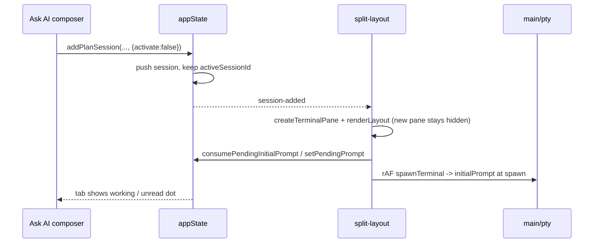

# Ask AI — focus retention setting (plan)

Status: planned, not implemented.
Date: 2026-10-20.
Scope: Preferences setting controlling whether an "Ask AI" send switches to the new
session tab or leaves focus on the current tab.

## Behavior spec

`Preferences.askAiFocus: 'switch' | 'stay'` — default `'switch'` (today's behavior: no
migration, no surprise on upgrade).

- `'switch'` — Ask AI creates the plan session, makes it the active tab, focuses it (current).
- `'stay'` — Ask AI creates the plan session in the background: it spawns, receives the
  prompt, runs. The tab bar shows it (`…` working → `?` your turn, unread dot) and the
  current tab keeps `activeSessionId` and DOM focus.

In scope: Ask AI composer in file panes (`file-prompt.ts`, both the plan-session and
custom-session paths) and the structurally identical browser-tab send flows
(Inspect / Draw / Flow "new session").

Out of scope: alert CTAs (`insight-alert.ts`, `large-file-alert.ts`, `tool-alert.ts`),
readiness "Fix", top-files "Split", GitHub "Plan a solution" / review, Kanban `runTask`.
Those are "open it and show me" actions and keep activating.

## Root cause of the tab jump

`attachSessionToProject` sets `project.activeSessionId = session.id`
(`src/renderer/state/session-factory.ts:123-134`); `commitNewSession` then pushes it onto
the nav ring and emits `session-added` / `session-changed`
(`src/renderer/state.ts:507-520`) → `renderLayout` → `renderTabMode` → `focusPane`
(`src/renderer/components/split-layout.ts:390-416`). `file-prompt.ts` never asks for the
switch, so the fix belongs in the state layer, not the composer.

## Background path already works (verified)

| Step | Evidence |
|---|---|
| Pane created + spawned even when hidden | `split-layout.ts:222-241` `onSessionAdded` creates the terminal pane and fires `spawnTerminal` in a rAF unconditionally |
| Prompt survives without the tab being shown | `setPendingPrompt` writes to the live instance created synchronously inside the `session-added` emit; `spawnTerminal` converts it to `pty.create(…, initialPrompt)` (`terminal-pane.ts:272-276`) |
| Every shipped provider accepts `startup-arg` | `claude-provider.ts:72`, `codex-provider.ts:36`, `copilot-provider.ts:42`, `gemini-provider.ts:87`, `pi-provider.ts:51`, `omp-provider.ts:48` — all `pendingPromptTrigger: 'startup-arg'`, delivery never needs a visible pane |
| User finds the session later | `session-unread.ts:38-56` sets the unread dot for any session that is not `activeSessionId` on a status change; tab glyph + desktop notifications already cover background sessions |

## Changes

- [ ] `src/shared/types.ts:406-434` — add `Preferences.askAiFocus?: 'switch' | 'stay'`
      (absent = `'switch'`). No change needed in `src/main/store.ts:29` defaults or the
      `store:startup-prefs` channel (`src/main/ipc-handlers.ts:442-445`, theme/zoom only).
- [ ] `src/renderer/state/session-factory.ts:123` —
      `attachSessionToProject(project, session, { addToSwarm?, activate? = true })`; assign
      `activeSessionId` only when `activate`. All 12 existing callers keep current behavior.
- [ ] `src/renderer/state.ts:476` (`addSession`) and `:462` (`addPlanSession`) — accept
      `opts?: { activate?: boolean }`, forward to attach and to `commitNewSession` so it
      skips `pushNav` when not activating (otherwise `Cmd+[` lands on a tab the user never
      opened). `session-added` / `session-changed` / history entry still fire.
- [ ] `src/renderer/ask-ai-focus.ts` (new) — pure
      `shouldActivateAskAiSession(prefs: Pick<Preferences, 'askAiFocus'>): boolean`, same
      shape as the `pane-focus.ts` / `pane-order.ts` precedent: decision unit-testable
      without DOM.
- [ ] `src/renderer/components/file-prompt.ts:283-305` — `submit()` passes
      `{ activate: shouldActivateAskAiSession(appState.preferences) }`;
      `submitToCustomSession()` forwards the same flag.
- [ ] `src/renderer/components/tab-bar/session-menu.ts:62,172` —
      `promptNewSession(onCreated?, opts?: { activate?: boolean })` forwarded to
      `appState.addSession`; default `true` leaves other callers unchanged.
- [ ] `src/renderer/components/browser-tab/draw-mode.ts:97,116` and
      `session-integration.ts:36,61` — same flag on the new-session sends. The
      "send to running session" path keeps its deliberate `setActiveSession`
      (`session-integration.ts:26`).
- [ ] `src/renderer/components/preferences/general-section.ts:46-145` —
      `createCustomSelect('pref-ask-ai-focus', …)` row after `copyOnSelect`; `save()` →
      `appState.setPreference('askAiFocus', …)`. Select, not checkbox: the repo uses
      `custom-select` for enums and bans native `<select>`.
- [ ] `src/renderer/locales/en.json` + `zh-CN.json` (`general.*`) —
      `askAiFocus: "Ask AI opens the new session in"`,
      `askAiFocusSwitch: "a new focused tab"`,
      `askAiFocusStay: "the background — keep my tab"`.

## Edge cases

- Swarm / split: `addToSwarm` still appends to `splitPanes`, so in swarm every pane stays
  visible and the new one just renders dimmed; `focusPane` runs only from `renderTabMode`,
  so there is no focus steal to suppress. The setting is visually a near no-op in swarm —
  document it, do not special-case it.
- Hidden pane sizing: `fitTerminal` returns early for `.hidden` panes
  (`terminal-pane.ts:364-366`), so a background PTY runs at its spawn default and is resized
  by the `requestAnimationFrame(fitAllVisible)` on first show — same as any background tab today.
- No flash: under `stay`, `activeSessionId` is never touched, so `renderLayout` renders the
  current tab. No show-then-restore pair, no `shouldFocusPane` fight, no rAF-order dependency.
- Composer dismissal: Ask AI only exists in file panes (`file-prompt.ts:319`), so after
  `dismiss()` focus lands on `body` and stays out of the new terminal — that is what "stay"
  means here.
- Cross-project: both submit paths use `appState.activeProject`, and `onSessionAdded` reads
  the same (`split-layout.ts:194`), so the new session is always in the active project.

## Decisions taken

- Enum over boolean: a third value (e.g. "open in a split pane") needs no second preference.
- Default `'switch'` preserves current behavior for existing users.
- Widget/alert CTAs excluded — only document-context sends (file panes, browser tabs).

## Verification

- [ ] `npx vitest run src/renderer/state/session-factory.test.ts src/renderer/state.test.ts src/renderer/components/ask-ai-focus.test.ts src/renderer/components/file-prompt.test.ts src/renderer/components/preferences-modal.test.ts`
  - factory: `activate:false` appends the session, leaves `activeSessionId`, honors `addToSwarm`.
  - state: `addPlanSession(…, {activate:false})` → active tab unchanged, nav ring unchanged,
    `session-added` + `session-changed` fired, history entry created.
  - ask-ai-focus: absent pref → `true`.
  - preferences: select renders both options, `save()` persists the chosen value.
- [ ] `npx tsc -p tsconfig.renderer.json --noEmit`; `npm run build`; `git diff --check`.
- [ ] Runtime smoke (`npm start`): open a file tab, select text, Ask AI with `stay` →
  current tab unchanged, new tab glyph `…` then `?`, unread dot set, answer already in the
  transcript when switching to it. Flip to `switch` → old behavior.
- [ ] Docs: `docs/FEATURES.md` §8 General row (preference), §3 File reader/viewer row
  (Ask AI behavior), §6 browser-tab Inspect/Draw/Flow rows. `CHANGELOG.md` is
  release-generated — untouched.
